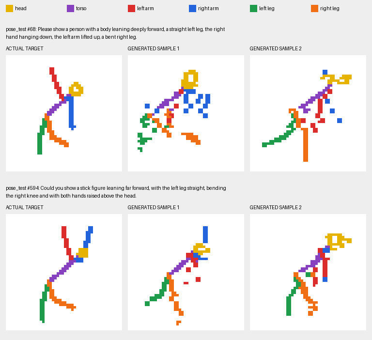

# Small Transformers, trained from scratch

Local PyTorch experiments for learning how Transformers work. All learn their embeddings and model weights from scratch; none uses a pretrained language model or image generator.

| Experiment | Input -> output | Model | Read more |
|---|---|---|---|
| [en2fr](en2fr/) | English sentence -> French sentence | Encoder-decoder Transformer, 16.65M parameters | [Architecture, training, and common mistakes](en2fr/README.md) |
| [text2image/fashion_mnist](text2image/fashion_mnist/) | Short clothing caption -> grayscale image | Causal pixel Transformer, 0.90M parameters at 28 x 28 | [Architecture, training, and common mistakes](text2image/fashion_mnist/README.md) |
| [text2image/stick_figures](text2image/stick_figures/) | Pose instructions -> stick figure, with unseen-combination tests | Small text encoder predicting continuous pose controls | [Dataset and evaluation](text2image/stick_figures/README.md) |
| [text2image/stick_pixels](text2image/stick_pixels/) | Pose descriptions -> directly generated binary pixels | Autoregressive pixel Transformer | [Pixel-only architecture and tests](text2image/stick_pixels/README.md) |
| [text2image/text2stick](text2image/text2stick/) | Plain-English descriptions -> directly generated pixels | English encoder and cross-attending pixel decoder | [Generate from English](text2image/text2stick/README.md) |
| [text2image/stick_colors](text2image/stick_colors/) | English -> colored body-part pixels | Palette-pixel Transformer with color/connectivity diagnostics | [Inspect colored limbs](text2image/stick_colors/README.md) |

## Colored stick-figure sample

English prompts to colored image pixels, trained locally from scratch. **Left: held-out target. Middle and right: generated samples for the same prompt.** The image includes a color legend for the head, torso, arms, and legs.



From checkpoint update 4,000. See the [colored experiment guide](text2image/stick_colors/README.md#sample-outputs) for the training-sample comparison, generation commands, and measured results.

The latest colored model uses 75,264 training samples and the validation-selected checkpoint at step 11,750 (latest resumable step 12,000). A [thirty-sample gallery](text2image/stick_colors/README.md#thirty-sample-red-arm-check) shows that the red arm can rise in familiar upright poses, while deep bending with a raised red arm remains unreliable. The gallery includes all outputs and links to 60 actual raised-red-arm training targets.

A **token** is one item represented by an integer: a text piece for the translator, or a caption word or pixel brightness for the image model. A **Transformer** processes sequences of these items using attention, which learns which earlier or input positions provide useful information. The translation and Fashion-MNIST models use **next-token prediction**. The stick-figure experiment instead predicts continuous pose controls from the complete text and tests held-out combinations. The translator predicts the next French subword while attending to English. The image model predicts the next grayscale pixel after reading a caption and preceding pixels.

## Environment and commands

Run all commands from the repository root, with your virtual environment active. A **virtual environment** (often shortened to **venv**) is an isolated Python installation and set of packages. Use module commands (`python -m ...`) so package imports resolve correctly; do not run the scripts directly from their experiment directories.

Dependencies:

| Experiment | Python packages |
|---|---|
| `en2fr` | `torch`, `numpy`, `datasets`, `tokenizers` |
| `text2image` | `torch`, `numpy`, `Pillow`; `tokenizers` for ordinary-English experiments |

The development environment is Python 3.11 with CUDA-enabled PyTorch on an RTX 3060 with 12 GB VRAM. Both experiments select CUDA when available and otherwise use CPU, which is slower. The translator enables BF16 whenever CUDA is selected; it currently assumes BF16-capable hardware.

### English to French

For a new dataset and model:

```powershell
python -m en2fr.prepare_data
python -m en2fr.train --steps 10000
python -m en2fr.translate "the weather is nice today"
```

If compatible prepared data and a trained checkpoint already exist, skip preparation and training to translate. Continue training with:

```powershell
python -m en2fr.train --resume --steps 5000
```

### Caption to clothing image

```powershell
python -m text2image.fashion_mnist.prepare_data --size 28
python -m text2image.fashion_mnist.train --size 28 --steps 5000
python -m text2image.fashion_mnist.generate --size 28 "draw a bag"
python -m text2image.fashion_mnist.generate --size 28 --all
```

Continue training with:

```powershell
python -m text2image.fashion_mnist.train --size 28 --resume --steps 5000
```

`--steps` means additional optimizer updates in both experiments. Without `--resume`, training starts from random weights and replaces that experiment's log and checkpoint files. Data preparation also replaces prepared artifacts; avoid rerunning it unnecessarily for an existing model.

## Repository layout

```text
en2fr/
  model.py           encoder, decoder, and attention blocks
  pipeline.py        token IDs, input encoding, artifact checks
  prepare_data.py    parallel text and byte-level BPE preparation
  train.py           training, validation, checkpoints, resume
  translate.py       greedy autoregressive translation
  test_pipeline.py   regression tests
  data/ checkpoints/ logs/       local generated artifacts
text2image/
  README.md          index of image-generation experiments
  fashion_mnist/
    model.py         caption vocabulary and causal pixel Transformer
    prepare_data.py  Fashion-MNIST download and quantization
    train.py         training, validation, checkpoints, previews
    generate.py      sampled images and PNG grids
    trace_batch.py   worked two-example attention/loss trace
    test_model.py    regression tests
    data/ checkpoints/ logs/ samples/   local generated artifacts
  stick_figures/     exhaustive pose dataset and compositional tests
```

Fashion-MNIST artifacts live under `text2image/fashion_mnist/`. Image artifacts at 28 x 28 use `28/` subfolders; existing 14 x 14 artifacts retain their original paths. Generated artifacts are ignored by Git and may need to be prepared or trained locally after cloning.

## Tests

```powershell
python -m unittest -v en2fr.test_pipeline text2image.fashion_mnist.test_model text2image.stick_figures.test_experiment
```

Tests cover the translator's padding invariance, tokenizer round-trip, sequence alignment, length filtering, LR schedule, and resume behavior; image tests cover prompts, causal masking, pixel alignment, both image resolutions, and PNG generation. These are correctness checks, not guarantees of translation accuracy or image quality.

## What to learn from the experiments

The architecture is only one part of a working generator. Training and generation must agree about start tokens, positions, vocabulary, and sequence boundaries. Padding masks, causal masks, and loss masks solve different problems. Good teacher-forced validation loss is useful evidence, but generated sentences and images are necessary quality checks.

Each experiment README explains these details alongside the implementation and records remaining limitations. These are intentionally small educational models, with limited translation quality and a ten-category image vocabulary.
