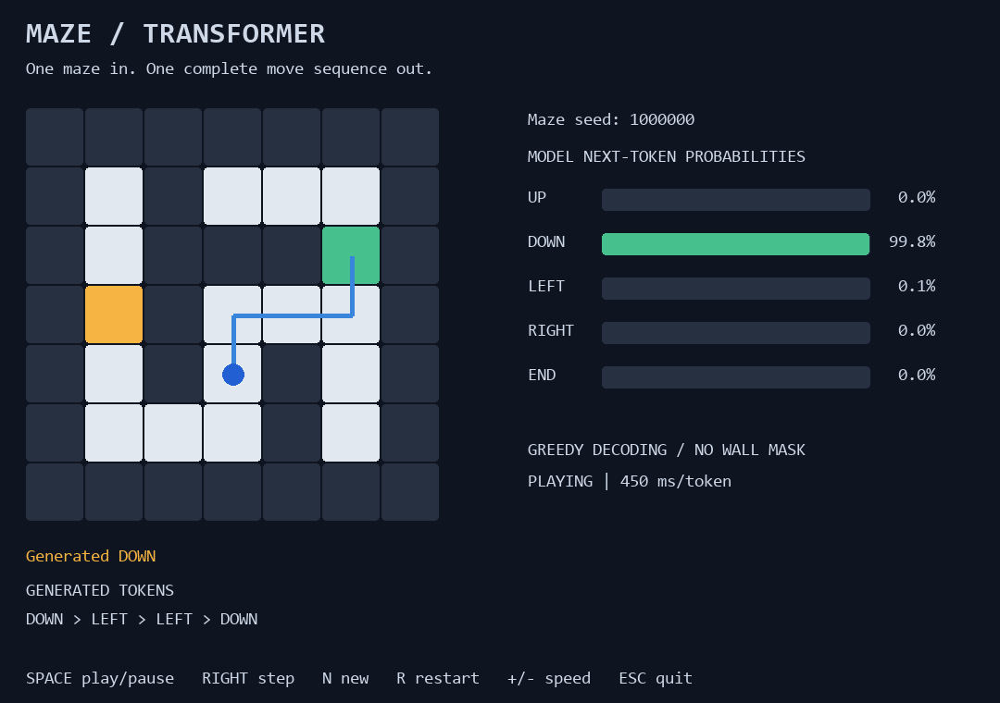
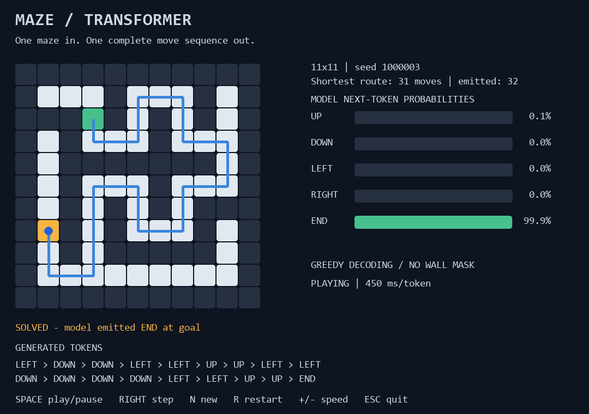

# Maze to moves

A small encoder-decoder Transformer learns a complete route from a maze matrix.
The Pygame viewer runs actual greedy decoding one token at a time and moves a
blue player after each token. Green is the start; gold is the goal.

Initial local checkpoint: 530,405 parameters, 1,000 optimizer updates, trained
on CPU in about 83 seconds (excluding setup and evaluation). On evaluation
seeds 1,000,000 through 1,000,049, it solved 45/50 mazes, all with shortest
routes; three attempts collided with walls and two otherwise failed to finish.
These are initial demo results on small grids, not a larger-maze claim.

## Run on Windows

The default launcher now uses **11x11** mazes and selects routes requiring
at least **24 moves**. Selection depends only on maze difficulty, never on
whether the model can solve it. The small original checkpoint is preserved.
The sidebar displays grid size, shortest-route length, and emitted token count.

The 11x11 checkpoint has 538,085 parameters and 7,000 total updates (4,000
at learning rate 0.0005, then 3,000 at 0.0001). It solved 77/100 general
evaluation mazes, with 75 shortest routes. On the first 50 evaluation mazes
whose shortest routes require at least 24 moves, it solved 36/50, all with
shortest routes; the other 14 collided with walls. These checkpoints were
assessed repeatedly during this demo, so these are development measurements,
not an untouched final benchmark.

From the repository root, using the isolated experiment environment:

```powershell
python -m venv .venv-maze
python -m pip --python ./.venv-maze/Scripts/python.exe install torch pygame-ce numpy
./.venv-maze/Scripts/python.exe -m maze.train --size 11 --steps 3000
./.venv-maze/Scripts/python.exe -m maze.demo --size 11 --min-route 24
```

If the environment and checkpoint already exist, run only the last command.
You can also double-click `maze/play.cmd` to open the viewer.
SPACE plays/pauses, RIGHT generates one token, N selects the next maze, R
restarts the current maze, +/- changes speed, and ESC closes the window.
The viewer starts paused so you can inspect the input before generation.





Actual Pygame-rendered snapshot from the 7,000-update checkpoint, maze seed
1,000,003. The model generated 31 moves followed by END and reached the goal
along a shortest route. Blue traces the generated route; green marks the start
and gold the goal. The probability bars show the final decoding step, and the
token strip shows the last 18 tokens (32 total tokens including END).

```powershell
./.venv-maze/Scripts/python.exe -m maze.train --size 11 --resume --steps 1000
./.venv-maze/Scripts/python.exe -m maze.train --size 11 --evaluate --eval-count 100
./.venv-maze/Scripts/python.exe -m maze.train --size 11 --evaluate --eval-count 50 --min-route 24
./.venv-maze/Scripts/python.exe -m unittest maze.test_maze -v
```

## What is learned

The encoder sees the complete maze once, flattened in row order, with
learned row/column embeddings. Cell IDs mean wall, floor, start, and goal.
The two-layer decoder cross-attends to this memory and predicts UP, DOWN,
LEFT, RIGHT, or END using its previous output tokens. It starts with BOS.
There are no pretrained weights, local observations, replanning, wall masks,
search fallback, or hand-coded navigation rules in inference.

Training uses 12,000 procedural depth-first-carved mazes with random endpoints.
Breadth-first search supplies shortest-route training targets. The BFS solver
is never used to choose viewer moves. The decoder is trained with teacher
forcing; autoregressive route evaluation is therefore essential.

Evaluation uses seeds beginning at 1,000,000, separate from training seeds.
Different seeds can still produce identical maze layouts, particularly on
small grids; this is a demo, not a rigorously deduplicated research benchmark.
The default viewer uses that evaluation seed range and never selects only
successful examples. Wall collisions, early END, and exceeding the move limit
are displayed as failures. Reaching the goal must be followed by END.

Model weights, optimizer state, and evaluation counts live in checkpoints/.
The original 7x7 model uses model.pt; larger models use model-11.pt, etc.
To revisit the original demo, use `python -m maze.demo --size 7`.
Other odd sizes are supported but require their own training run; the viewer
does not stretch a small-maze model onto larger inputs.
For a lower-learning-rate continuation, add `--lr 0.0001` to the resume command.
A fresh training run replaces that experiment's checkpoint. --resume restores
weights and optimizer state but does not reproduce the exact uninterrupted
data-sampling stream. Training size is fixed in each checkpoint; a larger
grid requires a fresh model. Larger-maze generalization is not established.

Prior art: [Maze Transformer](https://github.com/understanding-search/maze-transformer)
and [multi-step maze prediction](https://facebookresearch.github.io/maze_navigation_MLMU/).
