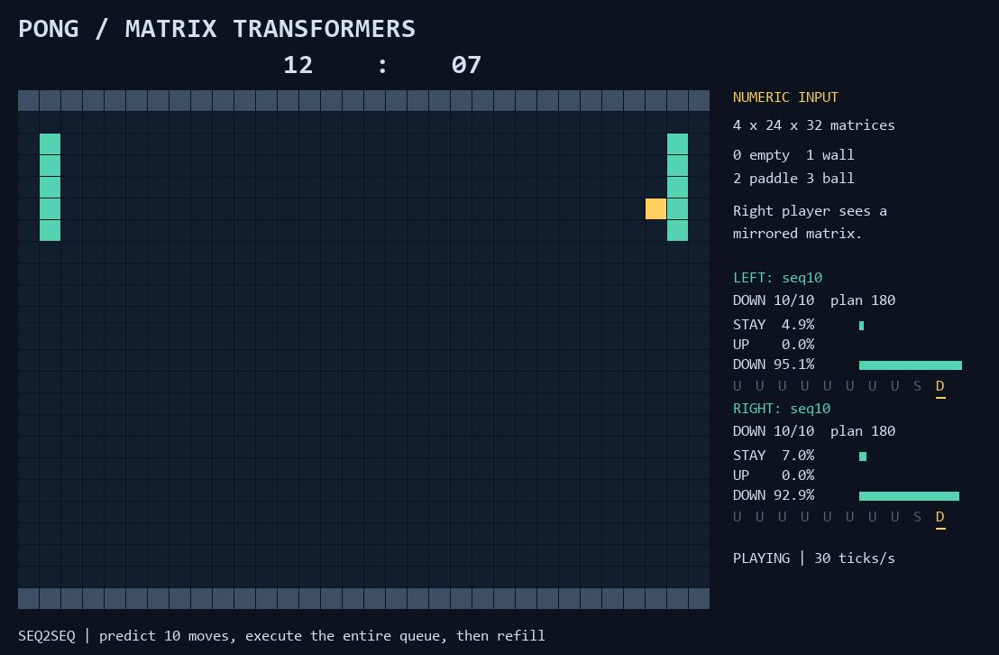

# Pong: matrix history to the next 10 moves

A Transformer encoder reads numeric screen matrices. An autoregressive
Transformer decoder generates **exactly ten actions**. Each neural player
executes its entire queue without consulting the model, then refills from the
latest history. Two independently instantiated players can face each other.



## Run

Use the existing shared `venv02-cu126`; do not create another environment.
From the repository root:

```powershell
& 'C:\Users\ferey\PycharmProjects\venvs\venv02-cu126\Scripts\Activate.ps1'
python -m pong.prepare_data
python -m pong.train
python -m pong.demo
```

Dependencies: `torch`, `numpy`, `pygame`, `Pillow` (already in the shared venv).
To launch without activation:

```powershell
& 'C:\Users\ferey\PycharmProjects\venvs\venv02-cu126\Scripts\python.exe' -m pong.demo
```

New data: `pong/data/seq10.npz`. Checkpoints: `pong/checkpoints/seq10.pt`
(latest/resumable), `seq10-best.pt` (best validation loss). Old single-action
artifacts are preserved but cannot be loaded by this sequence architecture.
Generated data, weights and logs are Git-ignored.

## Input and output

The input at each **refill** is four recent **24 by 32 integer matrices**,
oldest first: 0 = empty, 1 = wall, 2 = paddle, 3 = square ball. These are
simulation occupancy values, not RGB images or screenshots. The model receives
no coordinates, velocities, scores, future observations or expert fallback.
The right player's matrices are mirrored so its own paddle appears on the left.

One-hot cell values in 4 by 4 patches project to 64 dimensions. Spatial and time
embeddings distinguish 48 patches in each of four frames. Two encoder layers
with four heads process 192 input tokens. Two decoder layers use causal action
self-attention and cross-attention to the encoder output.

The output vocabulary is `STAY`, `UP`, `DOWN`. `BOS` is a decoder input only.
There is no EOS: output length is fixed at ten. During training:

```text
decoder input: BOS   a1   a2   a3 ... a9
target:         a1   a2   a3   a4 ... a10
```

During play the encoder runs once per refill; greedy autoregressive decoding
generates all ten moves before any move executes:

```text
latest history -> predict [a1 ... a10]
execute a1 -> a2 -> ... -> a10      (no model calls or corrections)
latest history -> predict the next ten moves
```

Each player owns its queue and cursor. Scored points do **not** flush pending
moves: they continue even after a new serve. A manually restarted match clears
both queues. The viewer highlights the executing move, dims consumed moves,
and displays `01/10` through `10/10` plus the plan number. Displayed action
probabilities were computed during refill; they are not recomputed each tick.

## Sequence demonstrations and training

The default scripted teacher tracks the visible ball row. `--teacher intercept`
uses a predictive expert that accounts for wall reflections. Teacher physics
is available only during recording, never to the learned player.

For every sampled history, the recorder clones the simulation and runs both
experts for ten ticks. Their actual future moves form two ten-token targets.
The lookahead does not change the original game. Targets crossing a random new
serve are skipped, since that serve cannot be predicted from the given history.
During real play the queue still finishes across points.

Defaults: 30,000 training and 3,000 held-out sequences from disjoint seeded
rallies. Varied paddle starts and action perturbations provide recovery states.
Matrices are losslessly packed four two-bit cells per byte on disk.

Training uses teacher forcing, causal masks, cross-entropy over all ten output
positions, and AdamW. Validation reports token accuracy, exact sequence accuracy,
accuracy at each future position, and free-running generation accuracy on up to
256 examples. Actual matches separately test the ten-tick open-loop controller.

```powershell
python -m pong.train --resume --steps 3000
python -m pong.prepare_data --checkpoint pong/checkpoints/seq10.pt --append --samples 10000 --seed 20000000
python -m pong.train --resume --steps 3000
```

Model-assisted collection assigns each side to learned queues or the perturbed
teacher for an entire rollout; expert lookahead still supplies sequence labels.
Use a new disjoint seed range per appended batch. Appending preserves validation
and rejects incompatible teachers or one-action datasets. `--steps` means
additional updates; resume restores weights, optimizer, count and Torch RNG.
Fresh preparation or non-resume training replaces that command's output files.

## Play, evaluate and record

```powershell
python -m pong.demo --left human --right pong/checkpoints/seq10.pt
python -m pong.demo --left pong/checkpoints/seq10.pt --right expert
python -m pong.demo --left pong/checkpoints/seq10.pt --right pong/checkpoints/seq10-best.pt
python -m pong.evaluate --left pong/checkpoints/seq10.pt --right random
python -m pong.evaluate --left pong/checkpoints/seq10.pt --right expert
python -m pong.evaluate --left pong/checkpoints/seq10.pt --right pong/checkpoints/seq10.pt
python -m unittest -v pong.test_pong
python -m pong.demo --gif pong/match-seq10.gif --seconds 60 --gif-fps 15 --fps 30 --headless
```

Keys: **W/S** left human, **up/down** right human. **Space** pauses, **right
arrow** steps, **M** shows matrix values, **R** restarts, **+/-** changes speed,
**Esc** closes. Scripted opponent names: `tracker`, `expert`, `random`.

Matches default to five games of 3,000 ticks. Reports include points, wins,
returns, return rates and plan refill counts. A 1,500-tick match requires exactly
150 generations per neural player, even across points. The viewer, headless
evaluation and GIF recorder all use the same queue controller. Imitation is not
reinforcement-learning self-play, and ten-tick open-loop play may be weaker than
the original reactive model. The earlier `match.gif` records that original model.

Tests check exact ten-token generation, causal masking, shifted decoder inputs,
actual future expert targets and refill counts across points, alongside game
physics, matrix histories, mirroring, gradient learning and checkpoint loading.

## Measured sequence baseline

The 209,155-parameter model was trained for 6,000 updates on 30,000 sequences.
Teacher-forced accuracy on 3,000 held-out sequences was 84.87% per token. Greedy
free-running generation on 256 held-out examples achieved 79.69% token accuracy
and 32.81% exact ten-move accuracy. These metrics measure different things;
teacher forcing supplies previous expert actions during validation.

Two games of 1,500 ticks per matchup, starting at unseen seed 10,000,000:

| Matchup | Points (left : right) | Return rate (left : right) | Plan refills |
|---|---|---|---|
| Seq2seq vs random | 56 : 11 | 69.4% : 18.8% | 300 : scripted |
| Seq2seq vs predictive expert | 0 : 13 | 70.5% : 100% | 300 : scripted |
| Seq2seq vs another seq2seq instance | 26 : 11 | 71.8% : 50.9% | 300 : 300 |

These are small baseline evaluations. Open-loop forecasting and recovery after
points remain imperfect, and the two sides have different results on these
seeds. Every neural player generated exactly one plan per ten executed ticks;
there were no early refills after points. Full reports: `pong/logs/seq10-vs-*.json`.

## Cinematic highlights and numbered predictions

[Watch the cinematic highlights GIF](highlights-cinematic.gif): **6 minutes
10.6 seconds**, edited from 12 real Transformer-versus-Transformer matches
(48,000 ticks, 26.7 minutes at 30 ticks per second). The 32 distinct rallies
include eight edge saves, eight wall-then-racket returns, eight long exchanges,
and eight point endings or narrow misses. Key moments play at half speed, with
context before and after, scene cards, and fades through black at every cut.

```powershell
python -m pong.highlights
python -m unittest -v pong.test_highlights pong.test_pong
```

The recorder accepts `--checkpoint`, `--games`, `--ticks`, `--seed`, `--clips`,
`--min-seconds`, and `--output`. It scouts complete matches before selecting
excerpts. `highlights-cinematic.json` saves seeds, executed moves, score and
return totals, the checkpoint hash, source tick ranges, and edited timestamps.
Every excerpt stays inside one rally. The final scoring frame is preserved
before the simulation's automatic serve reset; no scene jumps into a new serve.
Rendering changes no actions, physics, or ten-move queue behavior.

The GIF and live viewer both show numbered circles for pending paddle-center
positions. **Actual racket cells have priority. In every remaining cell, only
the earliest pending prediction is shown.** Later predictions sharing that cell
are hidden. Numbers count forward from the next pending move; hidden numbers
still exist in the action queue. This prevents mixed circles and labels when
the paddle stays still, reverses direction, or reaches its travel limit. Actual
ball cells also remain unobscured. The ball's fading trail shows past motion,
not a neural prediction of its trajectory.

Checks cover overlapping projections, the earliest-token rule, terminal scoring
frames, queues continuing across points, and streamed GIF timing. The final
encoded reel was also decoded to verify its duration, looping, all 32 scene
boundaries, black transitions, and visible prediction markers.
