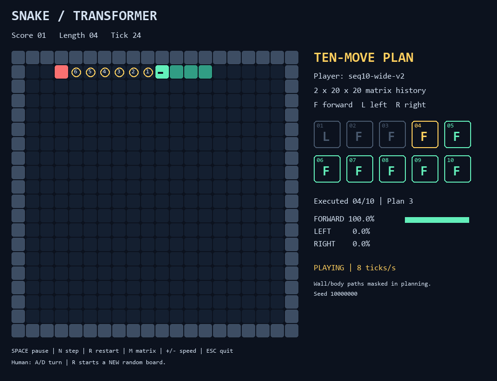
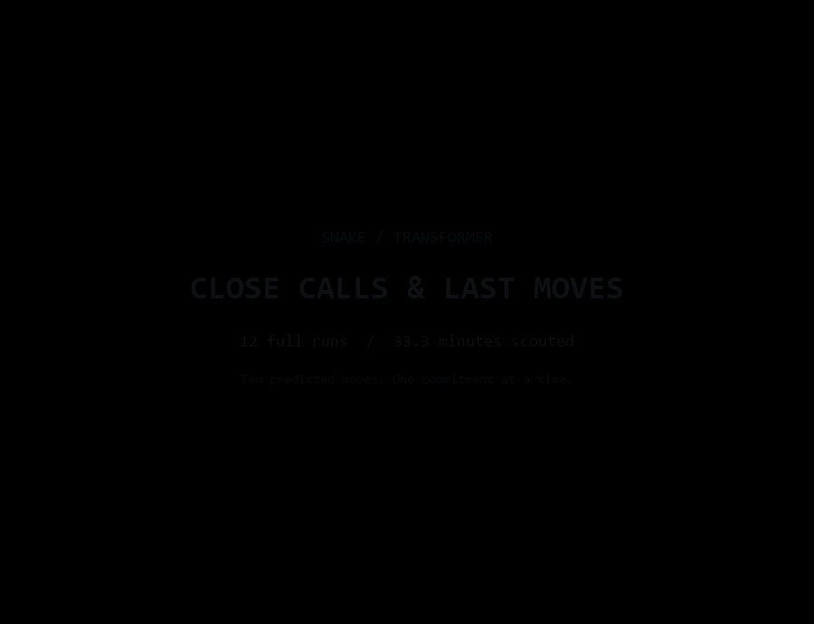

# Snake: board history to the next 10 moves

A small encoder-decoder Transformer, trained from scratch, reads numeric Snake
boards and autoregressively predicts **exactly ten moves**. It executes that
entire queue before observing the board again. The viewer shows all ten tokens,
the executing token, its probabilities, and a projected path for pending moves.



Run from the repository root with the existing shared environment:

```powershell
& 'C:\Users\ferey\PycharmProjects\venvs\venv02-cu126\Scripts\Activate.ps1'
python -m snake.demo
```

To prepare and train on a fresh checkout:

```powershell
python -m snake.prepare_data --samples 20000
python -m snake.train --steps 9000 --eval-every 1000
python -m snake.demo
```

Dependencies: `torch`, `numpy`, `pygame`, already in the shared `venv02-cu126`.
No download, pretrained weights, or additional environment is needed.
Generated datasets, weights, and logs are Git-ignored. Data preparation replaces
`snake/data/seq10-wide-v2.npz`; fresh training replaces
`snake/checkpoints/seq10-wide-v2.pt`. The validation-selected model is saved as
`seq10-wide-v2-best.pt`. Earlier 12 x 12 data and weights are preserved.

```powershell
python -m snake.train --resume --steps 1000
python -m snake.demo --player snake/checkpoints/seq10-wide-v2-best.pt
python -m snake.demo --player human
python -m snake.demo --player expert
python -m snake.evaluate --games 30 --output snake/logs/wide-v2-model.json
python -m snake.evaluate --player random --games 30
python -m snake.evaluate --player expert --games 30
python -m unittest -v snake.test_snake
python -m snake.demo --headless --frames 4 --screenshot snake/preview.png
```

`--steps` means additional optimizer updates. Resume restores model, optimizer,
step count, and Torch RNG. `--device cpu` is available for training without CUDA.
The interactive viewer uses CPU inference for this small model.

Controls: **Space** pause, **N** single step, **R** restart, **M** numeric cells,
**+/-** speed, **Esc** close. Human mode: **A/D** or **left/right** turns once
relative to the snake's heading; it moves forward otherwise. Death stops play;
press R for a new random board, heading, and food placement. Launches are random
by default. Passing `--seed N` reproduces the initial board and restart sequence;
restarts still advance to new seeds. The active seed is displayed in the viewer.

The input contains two recent **20 x 20 matrices**, oldest first:

| Cell | Meaning |
|---|---|
| 0 | Empty |
| 1 | Wall |
| 2 | Snake body |
| 3 | Food |
| 4, 5, 6, 7 | Head facing up, right, down, left |

Heading is explicit because two identical initial frames cannot reveal motion.
The model receives no coordinates, game object, future food, or teacher actions.
Each 4 x 4 patch of eight-way one-hot cells projects to 64 dimensions. Learned
space and time embeddings identify 25 patches in each frame. Two four-head
encoder layers process 50 tokens; two causal decoder layers cross-attend to
that memory. There are 211,651 trainable parameters at the default size.

The action vocabulary is `FORWARD`, `LEFT`, `RIGHT`, relative to heading, so an
instant reverse is impossible. `BOS` is decoder input only; there is no EOS.

```text
training input: BOS a1 a2 ... a9
training target: a1 a2 a3 ... a10

latest board history -> encode once -> generate all ten moves
execute a1 -> a2 -> ... -> a10 -> refill from the latest history
```

Eating does not flush the queue. Death or a full board ends the episode; manual
restart clears the queue. During generation, a geometry mask rules out moves
that would hit walls, the currently visible body, or earlier cells in this plan.
A short search prefers actions that leave enough room to finish all ten moves.
The Transformer ranks the remaining actions. This happens once while producing
the queue; there is no per-tick action correction or early replanning.

The geometry check is deliberately conservative: it holds current body cells
occupied for all ten planned moves instead of guessing the tail's order. It
needs only the latest numeric board and does not inspect future food. If a full
safe plan is impossible under this approximation, it uses immediately safe
moves; a completely trapped snake can still die. `model.generate(x,
constrain=False)` exposes raw neural generation for analysis.

The projected path continues after food using the same known geometry. The
next food's location is not predicted. The probabilities shown in the viewer
are normalized over the actions allowed by the planning mask.

Training uses a breadth-first-search teacher that seeks visible food, with a
free-area heuristic when food is unreachable. It is a demonstration generator,
not a perfect long-term Snake solver. Mild random safe actions add recovery
states. Labels come from a cloned game and never modify the recorded state.
Training and validation use disjoint episode seeds.

New food is random and cannot be predicted from the current board. After the
known food is eaten in a recording, the label generator removes subsequent food
and teaches safe continuation for the remainder of the ten moves. This fixes the
old unsupervised suffix that often sent the snake into a wall after eating near
a corner. Labels stop before an unavoidable collision (`-100`, ignored in
cross-entropy). Corner and edge food starts are deliberately included in the
dataset. Hidden future food placement never influences labels.

Validation reports teacher-forced token accuracy, sequence accuracy and accuracy
at each supervised future position, including the number of labels available
at each position. Geometry-constrained generation metrics use up to 256 held-out examples;
they also ignore masked positions. A sequence match therefore does **not**
necessarily mean ten correctly predicted moves. Actual multi-episode play is
measured separately by `snake.evaluate`, including food score, lifetime, deaths,
and queue refills. A neural episode of N ticks requires exactly ceil(N/10)
model generations.

This is imitation learning, not reinforcement learning. Ten-move open-loop
control, random food changes, long bodies, and states unlike the demonstrations
can cause collisions even when validation accuracy is high.

The previous 12 x 12 baseline used unfiltered plans and labels that ended at food.
Its reports remain in `snake/logs/model.json`, `best.json`, `random.json`, and
`expert.json`; its scores do not measure the new board or planner.

The updated 20 x 20 model was trained on 20,000 sequences for 9,000 updates at
learning rate 0.0005. Teacher-forced validation accuracy on 1,500 held-out
sequences was 96.30%. Geometry-constrained generation on 256 examples achieved
95.00% token accuracy and 78.13% sequence accuracy. Update 7,000 had the lowest
validation loss and is retained separately as `seq10-wide-v2-best.pt`.

Thirty games on unseen seeds 10,000,000 through 10,000,029, capped at 500 ticks:

| Controller | Mean food | Mean ticks | Deaths | Wall deaths |
|---|---:|---:|---:|---:|
| Transformer + planning mask, update 9,000 | 17.70 | 446.00 | 12/30 | 0/30 |
| Random actions | 0.13 | 45.87 | 30/30 | 30/30 |
| Reactive BFS teacher | 36.53 | 487.70 | 2/30 | 0/30 |

The teacher replans every tick. The neural controller commits to ten actions,
including after eating. Its remaining deaths were body collisions; the geometry
approximation cannot guarantee escape from a body trap. Every neural episode
used exactly ceil(ticks/10) generations. Full reports are stored in
`snake/logs/wide-v2-{model,random,expert}.json`.

A separate corner check used all four corners, both approach headings per
corner, and distances one through six cells (48 cases). The final model ate the
corner food and survived its full ten-move queue in all 48 cases, with zero wall
collisions. Report: `snake/logs/wide-v2-corners.json`. The regression suite also
forces a model to prefer forward at every step and verifies safe corner turns,
including safe continuation after eating and new randomized restart states.

## Edited highlights



`highlights.gif` is a 76.5-second edit from 12 actual games (16,005 ticks,
33.3 minutes at the viewer's eight ticks per second). Ten games ended in a
crash and two reached a 5,000-tick limit. Six excerpts show food near an edge,
successful tight escapes, and two endings. Each clip keeps several seconds of
context; key moments play at half speed. Fade-through-black transitions and
clip/run title cards identify every cut, and crashes hold briefly before fading.

```powershell
python -m snake.highlights
python -m snake.highlights --reuse snake/highlights.json
```

The first command scouts new full games with automatic restarts, selects events,
and renders the GIF. `--games`, `--max-ticks`, `--seed`, `--clips`, and `--output`
are configurable. The second command re-edits the saved moves without scouting
again. The manifest records each seed, every executed move, the checkpoint hash,
and selected tick ranges. Replays verify final scores and terminal states; clip
selection and rendering never change the controller's actions.

The extended cut, [highlights-extended.gif](highlights-extended.gif), runs
**5 minutes 30 seconds** (4.32 times the original). It contains 28 distinct
scenes: 14 tight escapes, seven edge pickups, and seven endings, selected from
48 games and 85.25 minutes of simulated play. The board includes the app's
numbered prediction circles for pending moves, computed by the same projection
function as the live viewer. Black fades mark every cut. The original GIF is
preserved.

```powershell
python -m snake.highlights --reuse snake/highlights.json --extra-games 36 --max-ticks 3000 --seed 30102027 --clips 28 --output snake/highlights-extended.gif
python -m snake.highlights --reuse snake/highlights-extended.json --clips 28 --output snake/highlights-extended.gif
```
