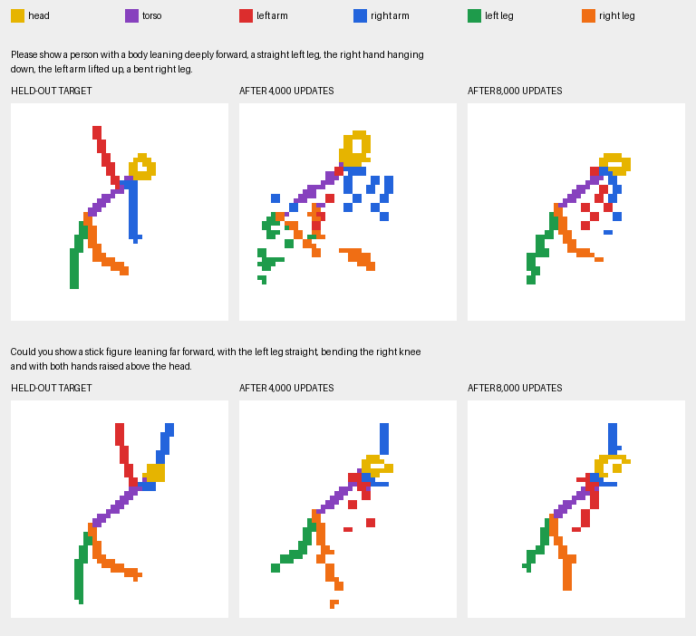

# Colored-pixel diagnostic results

The colors make part identity and fragmentation visible. They do **not** show that pose following is solved. The model often puts approximately appropriate colors in head/body/leg regions, but emits fragments, color spill, and incorrect limb poses.

## Longer-training comparison: 4,000 to 8,000 updates

The existing model was resumed for 4,000 additional updates, with batch size 16. Dataset and tokenizer hashes, architecture, loss, optimizer, and sampling settings were kept unchanged. The absolute-step learning-rate schedule continued without restarting warmup. The additional run took about 178 seconds, with peak allocated GPU memory still 0.89 GiB.

Generation now loads the validation-selected update 8,000. The resumable latest checkpoint is also update 8,000. Baseline weights are preserved under `checkpoints/baseline_step_4000/`; its measurements and raw outputs are under `results/baseline_step_4000/` and `samples/baseline_step_4000/`.

Validation NLL decreased from 0.06057 to 0.05352, an 11.6% reduction. The model has sampled 128,000 training examples in total: about 6.8 exposures per training record on average, compared with 3.4 before. No new examples were added.

| Split | NLL per pixel: 4k -> 8k | Part-color IoU: 4k -> 8k | Fully connected: 4k -> 8k |
|---|---:|---:|---:|
| word_test | 0.06226 -> 0.04867 | 0.10679 -> 0.10980 | 1/12 -> 4/12 |
| pose_test | 0.07751 -> 0.06356 | 0.06504 -> 0.12325 | 1/12 -> 3/12 |
| combined_test | 0.07696 -> 0.06424 | 0.06358 -> 0.09482 | 0/12 -> 2/12 |

All held-out generation settings remain identical: seed 42, temperature 0.8, guidance 2, and the same 12 prompts/references per split. Likelihood covers the full splits. The improved image overlap and connectivity are encouraging, but these small development samples do not establish reliable pose composition.

The familiar-prompt sample also improved mean color IoU from 0.08797 to 0.12924, but strict whole-image connectivity fell from 2/8 to 0/8. Cleaner individual strokes do not guarantee a completely connected image; stray pixels and detached heads/limbs remain.

This comparison uses exactly the same two held-out prompts, reference images, seed 123, temperature 0.8, guidance 2, and sample index 0. It does not select a favorable sample from either checkpoint. Legs look less fragmented, but the red left arm is still commonly lowered when the caption asks for it raised. Longer training helped image generation; it has not solved this pose error.

The [comparison metadata](docs/images/training-4000-vs-8000.json) records checkpoint steps, model configuration, data identities, prompts, and measurements. Original 4,000-update README sample images remain unchanged.

## Initial 4,000-update baseline

- 48 x 48 images, seven pixel colors including white background.
- 1,400,257 randomly initialized parameters; no binary-model or angle-model weights transferred.
- 18,816 training image/caption pairs from 84 combinations, with separate wording and pose holdouts.
- 4,000 updates, batch size 16, seed 7; about 188 seconds of training and 0.89 GiB peak allocated CUDA memory.
- Validation selected update 4000: average patch NLL per original pixel 0.06057. Best and latest checkpoints coincide for this run.

Targets use a fixed palette: yellow head, purple torso/neck, red left arm, blue right arm, green left leg, orange right leg. Left/right use canvas coordinates. Outputs contain predicted color IDs; RGB palette lookup is the only coloring step. There is no pose renderer or output repair during generation.

## Initial familiar-prompt visual check

`python -m text2image.stick_colors.compare` selected four fully specified training captions before sampling, using fixed selection seed 42. It generated two samples per prompt with sampling seed 123, temperature 0.8, guidance 2. See `docs/images/train-comparison.png`; original JSON/NPZ records are preserved under `samples/baseline_step_4000/`.

All eight outputs contain all six body colors. Only two of eight have fully connected foreground. Their mean six-part color IoU against their particular training targets is 0.08797. These are familiar training prompts, so this is not an unseen-pose success claim.

In the visual comparison, requested raised red arms are commonly lowered or fragmented, and orange/green legs can break into pieces. Thus color presence alone would give a misleadingly favorable result.

## Initial held-out diagnostics

The initial evaluation, preserved in `results/baseline_step_4000/evaluation-t0.8.json`, used seed 42, temperature 0.8, guidance 2. NLL covers full splits. Generated-image measurements use the first examples of 12 distinct combinations in each split; these are small deterministic samples.

| Split | NLL per pixel | All six colors present | Entire foreground connected | Mean part-color IoU | Shuffled-reference IoU |
|---|---:|---:|---:|---:|---:|
| word_test | 0.06226 | 100% | 1/12 | 0.10679 | 0.08115 |
| pose_test | 0.07751 | 100% | 1/12 | 0.06504 | 0.08178 |
| combined_test | 0.07696 | 100% | 0/12 | 0.06358 | 0.06247 |

The unseen-pose sample has worse color alignment than the shuffled reference baseline. Together with the failed raised-left-arm examples, this does **not** establish successful pose composition. The held-out combinations never enter gradient training, but these development holdouts have been inspected repeatedly across experiments; they are not an untouched research benchmark.

`python -m text2image.stick_colors.compare --split pose_test --count 2` provides an additional four-sample visual comparison in the original snapshot `docs/images/pose_test-comparison.png`. Its fixed selected targets require a deep bend and raised left arm, a pairing excluded from training. The generated samples visibly miss that pairing.

## Interpreting connections carefully

The report also gives per-color largest-component fractions and direct/within-two-pixel torso contact. These diagnose scattered fragments and proximity to the torso; they cannot verify a correct anatomical joint, distinguish proximal from distal contact, or prove the requested pose.

At a target's shared hip or shoulder, one stroke's color can occlude another. Consequently, even valid target colors do not always directly contact purple; target diagnostic values are included as a reference ceiling. For example, the first twelve wording-test target images have left-leg/purple contact within two pixels in only 5/12 cases, despite all their complete foregrounds being connected. Do not interpret that contact score in isolation as a broken limb.

Color IoU is sensitive to style and placement differences. All-six-color presence means at least one pixel per color, not six complete correct body parts. Entire-foreground connectivity is strict: one stray dot makes it fail. The images and multiple diagnostics should be read together.

## Verification

All 29 repository regression tests passed. New checks cover all 2,401 palette patch patterns, exact pixel orientation and loss normalization, cached attention and causal masking, English padding, gradients, split isolation, renderer-free palette generation, and an intentionally detached colored limb that the metrics correctly reject. Tests verify implementation behavior; visual quality remains limited.
